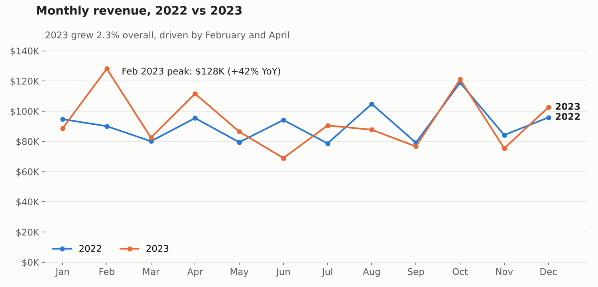
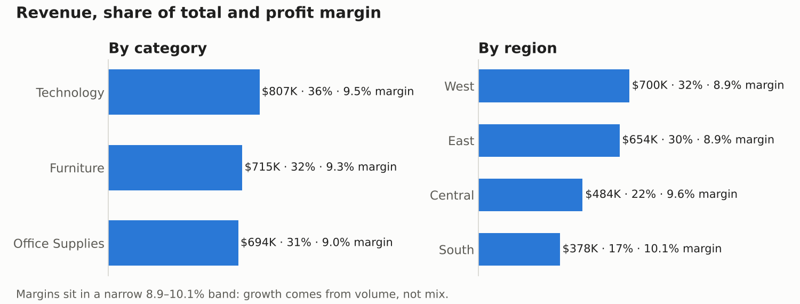

# Retail Sales Analysis — Python, SQL & Power BI

End-to-end analysis of retail orders: a Python ETL pipeline cleans the raw data and loads it into SQLite, SQL queries answer the key business questions, and a Power BI dashboard presents the results.



## Business problem

A retail business wants to know where its revenue and profit come from, so it can focus stock, promotions and regional effort. This project answers:

- Which products generate the most revenue, overall and in each region?
- Which categories drive sales, and how profitable are they?
- How does revenue trend month by month?
- Which sub-categories sell the most units, and which cities bring in the most sales?

## Key insights

9,994 orders across 2022–2023 brought in **$2.22M in sales and $205K in profit, a 9.3% margin**.

- **Technology leads.** It brings in 36% of revenue at the highest category margin (9.5%). Margins across all three categories sit within 9.0–9.5%, so growth comes from volume rather than from shifting the category mix.
- **West and East carry the business.** Together they make up 61% of revenue. The South is the smallest region (17%) but the most profitable, at a 10.1% margin.
- **Growth is flat and uneven.** 2023 revenue grew only 2.3%. February 2023 was the peak month ($128K, +42% year on year), while June 2023 fell 27%.
- **Revenue is concentrated.** One product (TEC-CO-10004722) accounts for 2.7% of all revenue across 1,862 products, and New York City alone accounts for 11%.
- **Thin-margin lines.** Fasteners (1.7%) and Labels (5.4%) earn far below the 9.3% average.

**Recommendations:** protect stock of the top Technology products; review pricing on Fasteners and Labels; and test expanding in the South, where each sale earns the most.



## Workflow

```text
Kaggle retail orders (CSV)
        ↓
Python & Pandas — clean and transform
        ↓
SQLite database (df_orders table)
        ↓
SQL analysis — 6 business queries
        ↓
Power BI dashboard
```

## Tools

Python (Pandas), SQL (SQLite), Power BI, Kaggle API

## Data preparation

Dataset: [Retail Orders by Ankit Bansal on Kaggle](https://www.kaggle.com/datasets/ankitbansal06/retail-orders).

- Treated the placeholder values "Not Available" and "unknown" as missing
- Standardized column names to snake_case
- Removed duplicate rows
- Converted `order_date` to a date type
- Added calculated columns:

```text
discount   = list_price × discount_percent × 0.01
sale_price = list_price − discount
profit     = sale_price − cost_price
```

`list_price` and `cost_price` are line totals (they rise with `quantity`), so summing `sale_price` gives revenue directly.

## SQL analysis

All queries are in [`SQL/retail_sales_analysis.sql`](SQL/retail_sales_analysis.sql):

1. Top 10 products by revenue
2. Sales and profit by category
3. Top 5 products per region, using a `ROW_NUMBER()` window function
4. Monthly revenue trend
5. Sub-categories by quantity sold
6. Top 5 cities by sales

## Power BI dashboard

The report is in [`e-commerce project powerbi.pbix`](e-commerce%20project%20powerbi.pbix). Open it in Power BI Desktop to explore the interactive version. The charts above were generated from the same SQL results.

## How to run

1. Install the requirements:

   ```bash
   pip install -r requirements.txt
   ```

2. Either set up a [Kaggle API token](https://www.kaggle.com/docs/api) so the script can download the data, or download `orders.csv` yourself.

3. Run the pipeline from the project folder:

   ```bash
   python Python/retail_sales_analysis.py                  # downloads from Kaggle
   python Python/retail_sales_analysis.py --csv orders.csv  # uses your own copy
   ```

The script builds `retail_orders.db`, runs every SQL query, prints the results and saves each one as a CSV in `outputs/`.

## Project structure

```text
├── Python/retail_sales_analysis.py   # ETL pipeline + runs the SQL analysis
├── SQL/retail_sales_analysis.sql     # business queries
├── e-commerce project powerbi.pbix   # Power BI report
├── images/                           # charts used in this README
└── requirements.txt
```

## Next steps

- Add customer-level analysis (repeat purchase rate, segment profitability)
- Schedule the pipeline to refresh the Power BI dataset automatically
